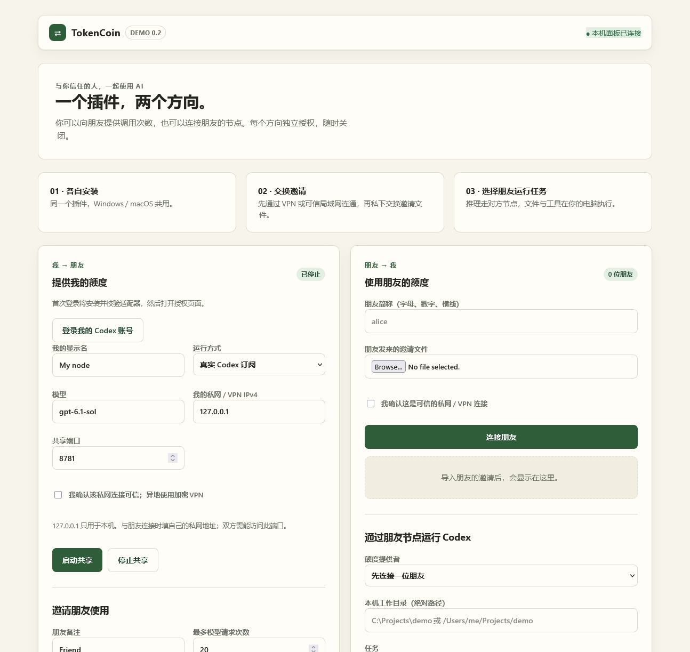

# TokenCoin 双向通道 Demo 0.3

**额度功能开发进度：** 正式下载版仍为 v0.3.0，按请求次数限制。任务归属隔离、缓存用量记录与离线校准代码见 [开发分支](https://github.com/youshangdekongjunsiling-spec/tokencoin-channel/tree/work/weekly-usage-calibration)，方法与实测边界见 [说明](https://github.com/youshangdekongjunsiling-spec/tokencoin-channel/blob/work/weekly-usage-calibration/codex-channel/WEEKLY_BUDGET.md)。真实周比例拟合和百分比放行尚未验收。

**双方安装同一个插件，复制邀请串给朋友，对方粘贴即可连接，无需手动组局域网或 VPN。** 可以向朋友提供自己的模型调用，也可以使用朋友提供的通道。



## 下载与安装

从 [v0.3.0 Release](https://github.com/youshangdekongjunsiling-spec/tokencoin-channel/releases/tag/v0.3.0) 下载 `tokencoin-channel-v0.3.0.zip`，完整解压并保留隐藏的 `.agents` 目录。

- Windows x64：双击 `install-windows.cmd`。
- Apple 芯片 Mac：终端进入解压目录，运行 `bash install-macos.command`。需要原生 ARM64 Python。
- 双方需要 Python 3.10+ 和 Codex CLI。安装器会下载并校验固定版本 iroh 网络组件，保存在个人 TokenCoin 目录。
- 重新打开 Codex，查找 **TokenCoin 双向通道**。侧栏按钮由宿主加载，当前位置仍需宿主实测。
- 也可直接用 `start-panel-windows.cmd` 或 `bash start-panel-macos.command` 打开本机浏览器面板，每台电脑同时保持一个面板。

[详细安装与双人操作步骤](codex-channel/INSTALL.md) · [高级私网命令行指南](codex-channel/README.md)

## 第一次使用

1. 提供方在自己的面板登录 Codex，保持“快速连接”，填显示名和模型，启动共享。
2. 设定次数与有效期，点“生成邀请串”，复制后私下发给朋友。
3. 朋友在右侧填写简称、粘贴邀请串，点“连接朋友”。本版需粘贴到面板，尚未注册点击链接自动唤起。
4. 朋友选择额度提供者、自己电脑的工作目录与权限，运行任务。
5. 反方向使用时，朋友也发一份独立邀请给你。双方各自保留撤销权。

原始账号授权保留在提供方电脑。邀请串含受限通行证，请勿公开、贴进 AI 聊天或日志。供应者能看到模型请求上下文；文件工具在消费者电脑执行。

## 自动连接原理

```text
朋友 Codex CLI → 朋友本机转接 → iroh 加密直连 / 中继 → 你的本机网关 → 你的模型授权
```

插件自动尝试直连，必要时使用 iroh 公共中继。中继看不到加密内容，可观察连接与流量元数据。公共中继适合 Demo，有限流且无 SLA；双方均需在线。后续可评估独立中继与短配对码服务。当前使用高熵长邀请串。

## 已验证与边界

- 39 项测试通过，无跳过，涵盖原通道及快速连接、SSE、无效授权、限额、撤销、连接恢复、清理。
- Windows 本机两个不同加密端点通过邀请连接；公共中继可达，连接随后使用本机直连。
- 真实 Codex CLI 经快速通道完成一次中文短句任务，退出码 0，测试邀请已撤销、服务已关闭。
- macOS 实机、朋友异地双机和强制中继传输仍待验证；本机时间不代表跨机延迟。证据见 [verification.json](docs/verification.json)。
- 次数按模型请求尝试计，一个任务可有多轮；不提供金额/token 硬限额。中断不自动重放。
- 默认面板支持订阅适配器和 mock；API 路径保留高级 CLI。当前桌面对话的模型配置不自动切换。
- 上游服务决定订阅可共享范围。

## 开发验证

```sh
python -B codex-channel/scripts/setup_quick_connect.py
python -B -m unittest discover -s codex-channel/tests -v
```

快速连接基于 [iroh 1.2.0](https://pypi.org/project/iroh/1.2.0/)，[中继限制](https://docs.iroh.computer/concepts/relays)与[安全说明](https://docs.iroh.computer/deployment/security-privacy)见官方文档。账号适配器固定 CLIProxyAPI 8.0.47，单独下载校验；发布包不含账号、个人状态、邀请或上游二进制。
